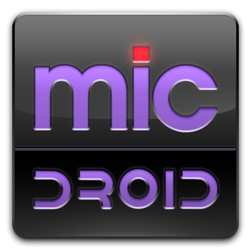
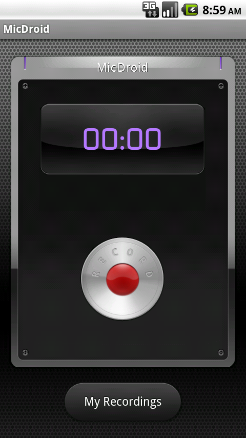
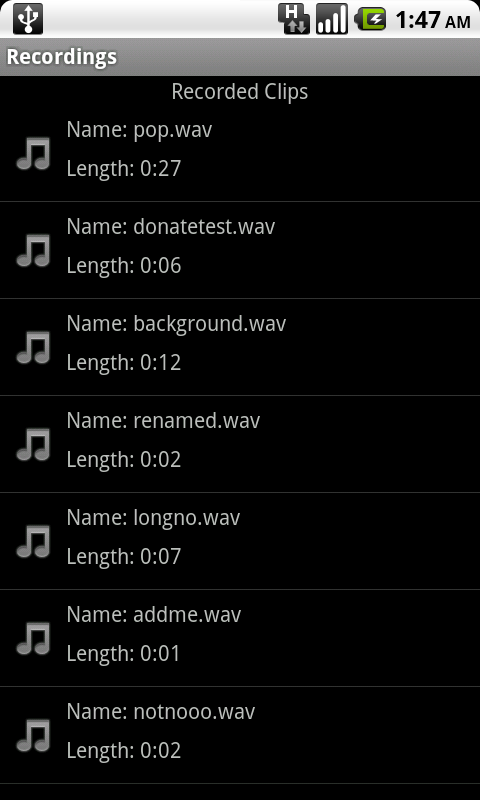
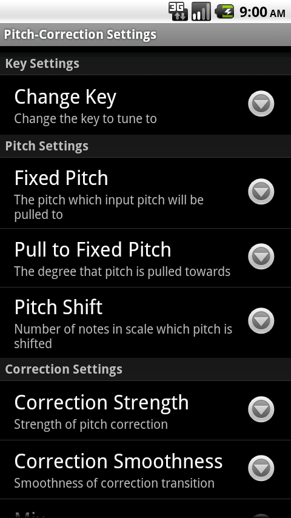
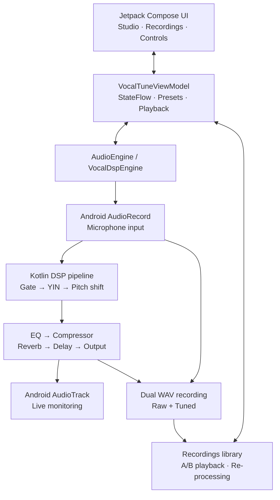

<!--
  VocalTune Studio
  Repository: https://github.com/vantom-404/VocalTune
-->

<div align="center">

  

  <h1>VocalTune Studio</h1>

  <p><strong>Your voice. Your key. Your sound.</strong></p>

  <p>
    A real-time vocal pitch-correction and audio-effects studio for Android.
    Tune live vocals, shape your sound, and keep both the original and processed recordings.
  </p>

  <p>
    <a href="https://github.com/vantom-404/VocalTune/releases">
      
    </a>
    <a href="https://github.com/vantom-404/VocalTune">
      
    </a>
    <a href="https://github.com/vantom-404/VocalTune/issues">
      
    </a>
    <a href="https://github.com/vantom-404/VocalTune/blob/main/README.md">
      
    </a>
  </p>

  <p>
    
    
    
    
    
  </p>

  <p>
    <a href="#-overview">Overview</a> ·
    <a href="#-features">Features</a> ·
    <a href="#-screenshots">Screenshots</a> ·
    <a href="#-getting-started">Get started</a> ·
    <a href="#-architecture">Architecture</a> ·
    <a href="#-contributing">Contributing</a>
  </p>

</div>

---

## 🎧 Overview

**VocalTune Studio** is an Android application for real-time vocal pitch correction and vocal processing. It captures microphone input, detects the fundamental pitch, maps it to a selected musical key and scale, and processes the signal through a configurable vocal-effects chain.

The app is designed around a practical recording workflow: monitor your voice while tuning, record the processed performance alongside an untouched raw version, compare both takes, and re-render a recording with different tuning settings.

> **Project status:** The repository contains an actively developed Android application. Audio behavior and device latency can vary by Android version, microphone, audio route, and hardware. Treat the current build as a work in progress rather than a certified professional recording solution.

## ✨ Features

### 🎯 Real-time pitch correction

- Live microphone capture and audio monitoring.
- YIN-based fundamental-frequency detection.
- Musical key selection across all 12 chromatic notes.
- Five scale choices: Major, Natural Minor, Major Pentatonic, Minor Pentatonic, and Chromatic.
- Adjustable correction strength and retune speed.
- Bypass control for comparing the unprocessed input with the corrected signal.
- Live pitch, target-note, cents-offset, and input-level feedback.

### 🎚️ Vocal processing chain

The current Kotlin DSP engine includes configurable processing stages:

| Processor | Purpose |
| --- | --- |
| Input / master gain | Adjust input and output levels |
| Noise gate | Reduce low-level background noise between phrases |
| Pitch detector | Estimate the vocal fundamental frequency |
| Pitch shifter | Move voiced samples toward the selected target pitch |
| 3-band parametric EQ | Shape low, mid, and high frequencies |
| Compressor | Control vocal dynamics |
| Reverb | Add room and spatial character |
| Delay | Add adjustable echo with time and feedback |
| Output limiting | Help control excessive output peaks |

The available settings include EQ bands, compressor threshold and ratio, reverb mix, delay time and feedback, and dry/wet balance.

### 🎙️ Recording and vocal library

- Simultaneous **raw** and **tuned** WAV recording.
- Recording pause, resume, and stop controls.
- A recordings library for saved vocal takes.
- Raw-versus-tuned A/B playback comparison.
- Offline re-processing of saved vocal recordings with updated tuning settings.
- WAV handling based on 16-bit PCM audio.

### 🎨 Presets and interface

- Eight built-in vocal presets:
  - Natural Vocal
  - Hard Auto-Tune
  - Rap Vocal
  - Pop Vocal
  - Soft Correction
  - Robotic Voice
  - Deep Voice
  - Bright Voice
- Save and delete custom presets.
- Studio and Recordings sections.
- Jetpack Compose interface with Material 3 components.
- Foreground recording service for maintaining an active recording session.

## 📸 Screenshots

The screenshots below are taken from the repository's `market/` assets.

<div align="center">
  
</div>

<table>
  <tr>
    <td width="33%" align="center">
      
      <sub><strong>Studio</strong></sub>
    </td>
    <td width="33%" align="center">
      
      <sub><strong>Vocal controls</strong></sub>
    </td>
    <td width="33%" align="center">
      
      <sub><strong>Recording workflow</strong></sub>
    </td>
  </tr>
</table>

## 🧰 Technology stack

| Area | Technology |
| --- | --- |
| Platform | Android |
| Primary language | Kotlin, with existing Java components |
| UI | Jetpack Compose |
| Design system | Material 3 |
| Architecture | ViewModel + StateFlow (MVVM-style) |
| Audio input/output | Android `AudioRecord` and `AudioTrack` |
| Signal processing | In-project Kotlin DSP components |
| WAV handling | In-project PCM/WAV utilities |
| Build system | Gradle Kotlin DSL |
| Android Gradle Plugin | 9.1.1 |
| Kotlin Compose plugin | 2.2.10 |
| Gradle wrapper | 9.3.1 |
| Compile / target SDK | 36 / 36 |
| Minimum SDK | 24 (Android 7.0) |
| Java compatibility | Java 21 |

### Audio engine notes

The active engine is implemented in Kotlin and uses Android's `AudioRecord` and `AudioTrack` APIs. It selects a 44.1 kHz or 48 kHz processing rate based on the available output-rate information and processes mono, 16-bit PCM frames.

The repository also contains `docs/NDK_OBOE_MIGRATION_PLAN.md`, which describes a possible future native C++/Oboe architecture. **That document is a migration plan, not evidence that the native Oboe engine is currently implemented or used by the app.**

## 🚀 Getting started

### Prerequisites

Install the following tools before building:

- **Android Studio** with Android SDK support.
- **JDK 21**.
- **Android SDK Platform 36** and the corresponding build tools.
- **Git**.

The Gradle wrapper downloads the configured Gradle distribution automatically. Android Gradle Plugin 9.1.1 is declared in the root build configuration.

### 1. Clone the repository

```bash
git clone https://github.com/vantom-404/VocalTune.git
cd VocalTune
```

### 2. Open the project

Open the cloned `VocalTune` directory in Android Studio and allow Gradle sync to finish.

### 3. Build a debug APK

**Windows (PowerShell):**

```powershell
.\gradlew.bat assembleDebug
```

**macOS / Linux:**

```bash
chmod +x ./gradlew
./gradlew assembleDebug
```

The debug APK is generated at:

```text
app/build/outputs/apk/debug/app-debug.apk
```

### 4. Install on a connected Android device

With USB debugging enabled and a device visible to ADB:

```bash
adb install -r app/build/outputs/apk/debug/app-debug.apk
```

You can also install the APK by transferring it to your Android device and opening it there, subject to your device's installation settings.

## 🎛️ Using VocalTune Studio

1. Launch VocalTune Studio.
2. Grant microphone access when Android requests it.
3. Open the **Studio** screen and start the audio engine.
4. Choose the musical key and scale that match your song.
5. Adjust correction strength and retune speed to set the tuning character.
6. Shape the vocal with the noise gate, EQ, compressor, reverb, delay, and gain controls.
7. Enable live monitoring when you want to hear the processed signal. Headphones are recommended to reduce acoustic feedback.
8. Start recording to capture the raw and tuned versions.
9. Open **Recordings** to listen, compare, manage, or re-process saved takes.

**Tuning tip:** Start with a key and scale that match the instrumental. Use a gentler correction amount and slower retune transition for a more natural result; increase correction strength and speed for a more pronounced Auto-Tune effect.

## 🏗️ Architecture

The application separates the Compose interface, state coordination, and audio-processing implementation.



### Source layout

The repository is organized as a single Android application module.

```text
VocalTune/
├── app/
│   ├── build.gradle.kts
│   ├── proguard-rules.pro
│   └── src/
│       ├── main/
│       │   ├── AndroidManifest.xml
│       │   ├── java/com/intervigil/micdroid/
│       │   │   ├── audio/       # Audio focus and WAV utilities
│       │   │   ├── dsp/         # Pitch detection and audio effects
│       │   │   ├── helper/      # Application and media helpers
│       │   │   ├── model/       # Audio state, settings, and presets
│       │   │   ├── service/     # Foreground recording service
│       │   │   └── ui/          # Compose UI, ViewModel, screens, theme
│       │   └── res/             # Android resources
│       └── test/                # Unit and QA tests
├── docs/
│   └── NDK_OBOE_MIGRATION_PLAN.md
├── market/                      # Store graphic, icon, and screenshots
├── gradle/
│   └── wrapper/
├── build.gradle.kts
├── settings.gradle.kts
├── gradle.properties
├── gradlew
├── gradlew.bat
└── README.md
```

## 🔐 Permissions and privacy

The Android manifest declares permissions for:

- `RECORD_AUDIO` — microphone capture.
- `MODIFY_AUDIO_SETTINGS` — audio configuration.
- `FOREGROUND_SERVICE` and `FOREGROUND_SERVICE_MICROPHONE` — foreground microphone service.
- `POST_NOTIFICATIONS` — recording status notification on supported Android versions.

Microphone access is required for live vocal processing. Android may display runtime permission prompts depending on OS version and device policy.

The repository includes an `.env.example` stating that no external secrets are required for the current setup. Do not add API keys, signing credentials, or personal data to source control.

## 🧪 Tests

The project contains JVM unit-test sources under `app/src/test`, including DSP engine tests and a studio QA test suite.

Run the available unit tests with:

```bash
./gradlew testDebugUnitTest
```

On Windows:

```powershell
.\gradlew.bat testDebugUnitTest
```

A successful build or test run on one machine does not guarantee identical audio behavior across all Android devices. Validate microphone routing, monitoring, recording, and playback on the target hardware.

## 🗺️ Roadmap

Potential development directions:

- [ ] Improve real-device audio latency and stability testing.
- [ ] Expand automated DSP and recording regression tests.
- [ ] Improve device and audio-route compatibility.
- [ ] Refine recording-library workflows and export handling.
- [ ] Evaluate and benchmark the proposed NDK/Oboe migration before adopting it.
- [ ] Expand user and developer documentation.

This roadmap is directional; items are not claims of already implemented functionality.

## 🛠️ Troubleshooting

<details>
  <summary><strong>Gradle sync or build fails</strong></summary>

  - Confirm that Android Studio is using JDK 21 for Gradle.
  - Confirm that Android SDK Platform 36 is installed.
  - Run `./gradlew --version` (or `gradlew.bat --version` on Windows) to inspect the JVM and Gradle versions.
  - Retry with `./gradlew clean assembleDebug` after resolving dependency or SDK issues.
</details>

<details>
  <summary><strong>The microphone does not start</strong></summary>

  - Grant microphone permission in Android settings.
  - Close other apps that may be holding the microphone.
  - Disconnect and reconnect the microphone or headset.
  - Check whether the selected audio route is supported by the device.
</details>

<details>
  <summary><strong>Live monitoring echoes or feeds back</strong></summary>

  - Use headphones instead of the device speaker.
  - Reduce monitoring/output volume.
  - Move the microphone away from speakers.
</details>

<details>
  <summary><strong>Audio crackles or sounds unstable</strong></summary>

  - Test with another headset or audio route.
  - Close other audio-intensive apps.
  - Re-test on the device's default sample-rate configuration.
  - Include the Android version and device model when reporting the issue.
</details>

## 🤝 Contributing

Contributions, bug reports, and practical device-testing feedback are welcome.

1. Fork the repository.
2. Create a focused branch:

   ```bash
   git checkout -b feature/your-change
   ```

3. Make and test your changes.
4. Commit with a clear message:

   ```bash
   git commit -m "feat: describe your change"
   ```

5. Push your branch and open a Pull Request.

For audio-related changes, include the device model, Android version, audio route, reproduction steps, and—when possible—a short description of the expected versus observed behavior.

## 🐛 Issues and support

- [Report a bug](https://github.com/vantom-404/VocalTune/issues/new)
- [Browse existing issues](https://github.com/vantom-404/VocalTune/issues)
- [View the source repository](https://github.com/vantom-404/VocalTune)

Please avoid attaching private recordings or sensitive audio unless you have checked that you are comfortable sharing them publicly.

## 📄 License

No `LICENSE` file or repository license declaration was present when this README was updated. Until a license is added by the project owner, the repository's reuse, modification, and redistribution terms are **not explicitly specified**. Add an appropriate license before inviting third-party redistribution or reuse.

## 🙏 Acknowledgements

VocalTune Studio builds on the Android platform and AndroidX ecosystem, including Jetpack Compose, Material 3, Lifecycle, and Navigation Compose. Thanks to the maintainers of these libraries and to everyone who tests, reports issues, and contributes improvements.

---

<div align="center">

  <strong>Made with 🎙️ and ❤️ by <a href="https://github.com/vantom-404">vantom-404</a></strong>

  <br />

  If VocalTune Studio is useful to you, consider giving the repository a ⭐.

</div>
